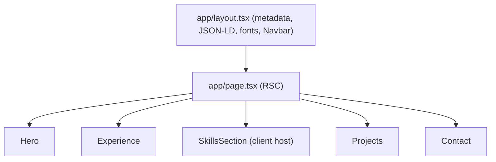
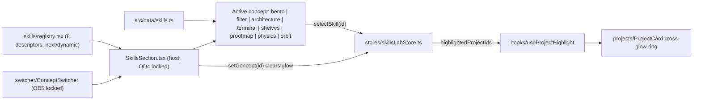

# Architecture

> Owner: Ahmad Elshowair · Last verified against the repository: 2026-10-22
> Governing authority: [.specify/memory/constitution.md](../.specify/memory/constitution.md) (v1.4.0). If this file and the constitution disagree, the constitution wins and this file must be corrected.

## System purpose

A single-page, statically rendered portfolio that proves Ahmad's full-stack claims with verifiable evidence. Recruiters must read the core stack in about 15 seconds. Engineering leads must be able to follow any skill claim to a shipped project in two interactions or fewer. Every public claim mirrors the canonical resume verbatim (Articles IV and VIII).

## Stack decisions

| Layer         | Technology                                                         | Reason                                                          | Constraints                                                                            |
| ------------- | ------------------------------------------------------------------ | --------------------------------------------------------------- | -------------------------------------------------------------------------------------- |
| Framework     | Next.js 16.1 App Router (`next dev --turbopack`)                   | Static generation, metadata API, RSC by default                 | Server Components by default; `"use client"` only on interactive leaves (Article XIII) |
| UI runtime    | React 19.2                                                         | Current stable, required by Next 16                             | Follow official React 19 guidance                                                      |
| Language      | TypeScript 5.9, strict mode                                        | Types as contracts                                              | Zero `any`; shared contracts in `src/definitions/` (Article II)                        |
| Styling       | Tailwind CSS 3.4 + `tailwindcss-animate`, `clsx`, `tailwind-merge` | Token-driven utility styling                                    | Palette locked to `#2c3531`, `#8DA55B`, `#F5E6D3` (Article IX)                         |
| Motion        | Framer Motion 12                                                   | Layout animations, springs, `MotionConfig`                      | 150–250ms, scale ≤ 1.05, `prefers-reduced-motion` respected (Articles VI and IX)       |
| Client state  | Zustand 5 (`src/stores/skillsLabStore.ts`)                         | Tiny shared store for the skills lab and cross-glow             | Selector hooks only; no other global store                                             |
| Icons         | `@iconify/react` via `src/components/iconify/`                     | One icon pipeline                                               | Skill icon strings in `src/data/skills.ts` are canonical                               |
| Typed text    | `react-type-animation` (`AnimatedRole.tsx`)                        | Hero role animation                                             | Hero only                                                                              |
| Backend / API | None                                                               | Static portfolio; contact uses `mailto:` plus copy-to-clipboard | No API routes, no env secrets                                                          |
| Database      | None                                                               | Content lives in typed modules under `src/data/`                | See Data model                                                                         |
| Hosting       | Vercel (`https://ahmad-elshowair.vercel.app`)                      | Native Next.js hosting                                          | Security headers set in `next.config.ts`                                               |
| CI            | GitHub Actions (`.github/workflows/ci.yml`)                        | Gate every push and PR to `main`                                | pnpm 9, Node 22: install, lint, typecheck, build                                       |

## System boundaries

- **Server (RSC, build time)** owns page composition (`src/app/page.tsx`), metadata, JSON-LD, `robots.ts`, `sitemap.ts`, and the server-rendered `<h1>` identity (Article X).
- **Client leaves** own interaction only: navbar, hero role animation, contact copy action, project card highlight ring, and the whole skills lab (`src/components/skills/**`).
- **External services**: none at runtime. Fonts load through `next/font` (`src/lib/fonts.ts`). Images are self-hosted in `public/` (Article V).
- **Out of scope**: authentication, databases, analytics, and third-party tracking scripts.

## Page composition



## Skills lab architecture (Specs 009–017)

The skills section is an evaluation lab. One host renders exactly one of eight interchangeable concepts at a time.



| Concept id | Folder                                         | Spec status (see `playbooks/tracker.md`) |
| ---------- | ---------------------------------------------- | ---------------------------------------- |
| 009        | `skills/bento/`                                | Done                                     |
| 010        | `skills/filter/`                               | Pending                                  |
| 011        | `skills/architecture/`                         | Pending                                  |
| 012        | `skills/terminal/` (current `DEFAULT_CONCEPT`) | Done                                     |
| 013        | `skills/shelves/`                              | In progress                              |
| 014        | `skills/proofmap/`                             | Pending                                  |
| 015        | `skills/physics/`                              | Pending                                  |
| 016        | `skills/orbit/`                                | Done                                     |

### Host and registry rules

- `registry.tsx` is the only place concepts are registered. Each descriptor has `id`, `label`, `blurb`, and a `next/dynamic` component with `ssr: true` and a shared loading state.
- `SkillsSection.tsx` owns the active concept, persists it to `localStorage` key `skills-concept` after mount (hydration-safe), and calls `setConcept` on every switch. Owner decision OD4 locks its heading; OD5 locks the switcher.
- Each concept folder exposes `index.ts` with both a named and a default export. The host imports nothing else from a concept.

### Cross-glow data flow

1. A concept calls `useSelectSkill()(skillId)`.
2. The store sets `selectedSkillId` and derives `highlightedProjectIds` from that skill's `projects`.
3. `useProjectHighlight(anchorId)` in each `ProjectCard` subscribes to that slice and toggles the glow ring.
4. Project pills are anchors to `#project-<anchor>`; scrolling is native.
5. Switching concepts calls `setConcept`, which clears selection and glow centrally.

Rule: glow is derived from selection only. A concept that previews on hover must commit `selectSkill(id)` before a pill click navigates (Spec 013 FR-010).

## Data model (static, typed)

| Module                    | Contents                                                                                                                                                   | Consumers                                        |
| ------------------------- | ---------------------------------------------------------------------------------------------------------------------------------------------------------- | ------------------------------------------------ |
| `src/data/skills.ts`      | `SKILL_CATEGORIES` (`Record<SkillCategoryId, string>`), `SKILL_PROJECTS`, `skills: SkillItem[]` (38 items: 14 frontend, 11 backend, 11 tools, 2 languages) | All skills concepts, the store, the terminal CLI |
| `src/data/projects.ts`    | Project cards and anchors                                                                                                                                  | `Projects`, skill project pills                  |
| `src/data/experiences.ts` | Experience timeline                                                                                                                                        | `Experience`                                     |
| `src/data/index.ts`       | Barrel (`export *`)                                                                                                                                        | Everyone imports from `@/data`                   |
| `src/lib/site.ts`         | `SITE_URL`, `SITE_TITLE`, `SITE_DESCRIPTION`, `AUTHOR`, `SOCIAL_LINKS`                                                                                     | Metadata, JSON-LD, sitemap, contact              |

Invariants:

- Counts are derived at runtime, never hardcoded.
- `SKILL_CATEGORIES` keeps its `string` value shape. Eight files outside `shelves/` read it as a string (`Orbit`, `StaticGrid`, `ProofMap`, `SkillCatalog`, `StreamView`, `cli.ts`, `Filter`, `Physics`). Add sibling maps instead of changing its shape.
- `skill.icon` values are owner-locked (OD3).

## Project structure

```text
src/
├─ app/                 layout, page, robots, sitemap, globals.css
├─ components/
│  ├─ Hero, Contact, Footer, AnimatedRole
│  ├─ navbar/ experience/ projects/ iconify/
│  └─ skills/
│     ├─ SkillsSection.tsx   host (locked)
│     ├─ registry.tsx        concept registry
│     ├─ switcher/           concept switcher (locked)
│     ├─ shared/             SkillEvidence, ProjectPills (shared by concepts)
│     └─ <concept>/          one folder per concept, index.ts barrel
├─ data/                single source of truth for copy and claims
├─ definitions/         shared TS contracts (index.ts + orbit.ts, terminal.ts)
├─ hooks/               useFinePointer, usePrefersReducedMotion, useDesktopViewport,
│                       useProjectHighlight, useActiveSection, useMenuFocusTrap,
│                       useSkillsSectionActive (barrel: index.ts)
├─ lib/                 site.ts (identity), fonts.ts, utils.ts (cn)
└─ stores/              skillsLabStore.ts (Zustand)
```

Placement rules:

- Concept-only modules stay inside the concept folder. The terminal split (`cli.ts`, `StreamView.tsx`, and others) and the bento split are the reference pattern.
- Modules shared by two or more concepts go in `skills/shared/`.
- Types shared across folders go in `src/definitions/`. Concept-private types may live in `<concept>.types.ts`.
- New hooks go in `src/hooks/` and are re-exported from `src/hooks/index.ts`.

## Operations

- **Environments**: local dev (`pnpm dev`) and Vercel production. No staging and no environment variables.
- **Security headers** (`next.config.ts`): `X-Content-Type-Options`, `Referrer-Policy`, `Permissions-Policy`, `Strict-Transport-Security`.
- **Verification gates** (Constitution, Additional Constraints): `pnpm lint`, `pnpm exec tsc --noEmit`, `pnpm build`, Lighthouse accessibility ≥ 97, and manual checks at 390px, 768px, and 1440px. Spec 013 also checks 360px and 1280px.
- **Performance budgets** (Article VII): LCP < 2.5s, CLS < 0.1, INP < 200ms, zero console errors.
- **Deploy and rollback**: Vercel deploys from `main`. Agents never push, merge, or deploy without an explicit instruction.

## Decisions and unknowns

- Confirmed: no backend, no database, no secrets, single store, eight-concept lab with one default.
- Confirmed: `docs/` is tracked publicly for engineering documentation (`docs/ARCHITECTURE.md`), while `playbooks/` and `specs/` remain machine-local (`gitignored`).
- Open: which concept becomes the permanent `DEFAULT_CONCEPT` after the lab finishes (currently `012`).
